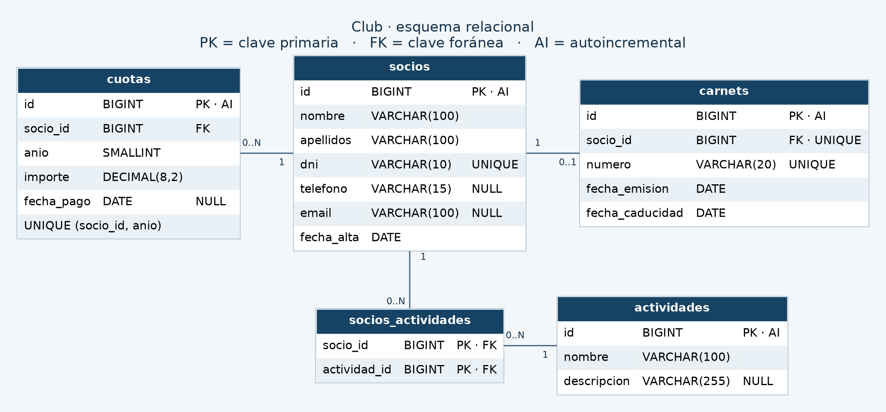

# Práctica JPA · Gestión de socios de un club

**2.º DAW · Desarrollo web en entorno servidor**

Amplía el CRUD de socios para gestionar las cuotas anuales, los carnets y la participación en actividades. Desarrolla la aplicación con Spring Boot, Spring Data JPA, MySQL y Thymeleaf, con entidades, repositorios, servicios, controladores y vistas.

---

## Modelo de datos

* Usa la base de datos `club`.
* El campo original `socios.cuota_pagada` se sustituye por `cuotas.fecha_pago`. Una cuota está pendiente mientras la fecha de pago sea `NULL`.
* Declara los identificadores de las entidades como `Long`. En MySQL, los campos `id` son `BIGINT AUTO_INCREMENT` y las claves foráneas que los referencian, incluidas las de la tabla intermedia, son `BIGINT`.
* Todos los campos son obligatorios salvo `socios.telefono`, `socios.email`, `cuotas.fecha_pago` y `actividades.descripcion`.
* El DNI del socio y el número del carnet son únicos.

| Relación | Regla |
| :--- | :--- |
| **Socio–Cuota (1-N)** | Un socio puede tener cero o más cuotas. Cada cuota pertenece a un socio. La combinación de socio y año es única. |
| **Socio–Carnet (1-1 opcional)** | Un socio puede tener cero o un carnet. Cada carnet pertenece a un socio. La clave foránea `carnets.socio_id` es única. |
| **Socio–Actividad (M-N)** | Un socio puede participar en cero o más actividades. Una actividad puede tener cero o más socios. Configura el mapeo para que JPA cree la tabla intermedia `socios_actividades` al generar el esquema. La clave primaria compuesta por `socio_id` y `actividad_id` evita inscripciones duplicadas. |

### Creación del esquema con JPA

Crea en MySQL la base de datos vacía y configura la conexión en `application.properties`. Define las entidades y sus relaciones para que Hibernate genere las tablas a partir del mapeo JPA, incluida la tabla intermedia de la relación M-N.

Durante el desarrollo, usa `spring.jpa.hibernate.ddl-auto=update` para que Hibernate cree las tablas y aplique los cambios de esquema que admite. Tras modificar las entidades, reinicia la aplicación y comprueba en MySQL que las tablas, los tipos, las claves y las restricciones coinciden con el diagrama. Repite la comprobación hasta que el esquema quede estable.

Cuando hayas comprobado que el esquema coincide con el modelo y ya no necesita cambios, usa `spring.jpa.hibernate.ddl-auto=validate`. Hibernate comprobará el esquema al iniciar la aplicación sin modificar las tablas.

---

## Casos de uso

La persona que administra el club debe poder realizar estas operaciones.

| ID | Caso de uso | Comportamiento esperado |
| :--- | :--- | :--- |
| **CU01** | Gestionar socios | Listar, dar de alta y editar socios. Comprobar que el DNI es único. Permitir eliminar un socio solo si carece de cuotas, carnet y actividades asociadas. |
| **CU02** | Consultar la ficha de un socio | Mostrar sus datos personales, las cuotas de cada año, su carnet si ya se ha emitido y las actividades en las que participa. |
| **CU03** | Crear una cuota anual | Seleccionar un socio e introducir el año y el importe. Crear la cuota como pendiente y admitir como máximo una cuota por socio y año. |
| **CU04** | Registrar el pago de una cuota | Seleccionar una cuota pendiente e introducir la fecha de pago. Mostrar la cuota como pagada. |
| **CU05** | Consultar las cuotas de un año | Seleccionar el año y listar las cuotas con el nombre del socio, el importe y el estado. Permitir mostrar solo las pendientes. |
| **CU06** | Emitir un carnet | Seleccionar un socio que aún no tenga carnet e indicar el número, la fecha de emisión y la fecha de caducidad. Comprobar que el número es único. |
| **CU07** | Renovar un carnet | Actualizar las fechas del carnet existente y conservar su número. |
| **CU08** | Gestionar actividades | Listar, crear y editar actividades. Permitir eliminar una actividad solo si no tiene socios inscritos. |
| **CU09** | Inscribir o retirar a un socio de una actividad | Asociar un socio a una actividad existente o retirar la inscripción. Evitar asociaciones duplicadas. |
| **CU10** | Consultar los participantes de una actividad | Mostrar los socios inscritos. Si la actividad está vacía, mostrar «Sin socios inscritos». |

---

## Escenario de prueba

1. Da de alta a Lucía Martín y crea sus cuotas de 2025 y 2026. Registra el pago de la primera y comprueba que la segunda sigue pendiente.
2. Emite su carnet y renuévalo. Comprueba que se actualizan las fechas y que Lucía conserva un único carnet con el mismo número.
3. Inscribe a Lucía en Senderismo y Fotografía. Inscribe a otro socio en Senderismo y comprueba que ambos aparecen en la lista de participantes.
4. Retira a Lucía de Senderismo. Comprueba que sigue inscrita en Fotografía y que el otro socio sigue en Senderismo.